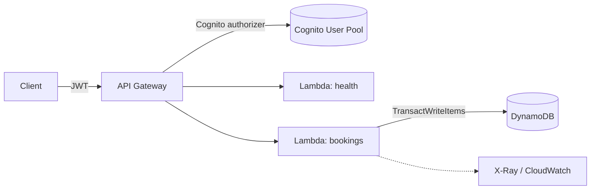

# 🩺 serverless-booking-api

> A serverless rebuild of my university project [MediBookings](https://github.com/Simphiw31/MediBookings): a secure medical-appointment REST API on AWS, deployed with infrastructure as code.


## 🏗️ Architecture


## ✨ Features
- 🔐 **Cognito JWT auth** on every route except `/health`
- 🚫 **No double-booking**: the booking and a slot "lock" item are written in one DynamoDB transaction with a condition check
- 👤 **Per-user isolation**: patients can only see and cancel their own bookings
- 📈 **Observability**: X-Ray tracing and structured CloudWatch logs
- 💸 **Pay-per-use**: on-demand DynamoDB and arm64 Lambda (near-zero idle cost)
- ✅ **CI**: GitHub Actions runs `sam validate --lint`, unit tests and `sam build`

## 📡 API
| Method | Path | Auth | Description |
|---|---|---|---|
| GET | `/health` | ❌ | Health check |
| POST | `/bookings` | ✅ | Create a booking `{doctor, date, time, reason}` |
| GET | `/bookings` | ✅ | List my bookings |
| GET | `/bookings/{id}` | ✅ | Get one booking |
| DELETE | `/bookings/{id}` | ✅ | Cancel a booking and free the slot |

## 🗄️ Data model (single table)
| pk | sk | Purpose |
|---|---|---|
| `USER#<sub>` | `BOOKING#<id>` | A patient's booking |
| `SLOT#<doctor>#<datetime>` | `LOCK` | Guarantees one booking per slot |

## 🚀 Deploy
**Prerequisites:** the AWS CLI (configured), the AWS SAM CLI and Python 3.12.
```bash
sam build
sam deploy --guided          # stack name: serverless-booking-api
```

### Try it out
```bash
API=<ApiUrl output>; CLIENT=<UserPoolClientId output>; POOL=<UserPoolId output>

aws cognito-idp sign-up --client-id $CLIENT --username you@example.com --password 'Passw0rd!x'
aws cognito-idp admin-confirm-sign-up --user-pool-id $POOL --username you@example.com
TOKEN=$(aws cognito-idp initiate-auth --client-id $CLIENT --auth-flow USER_PASSWORD_AUTH \
  --auth-parameters USERNAME=you@example.com,PASSWORD='Passw0rd!x' \
  --query 'AuthenticationResult.IdToken' --output text)

curl -X POST $API/bookings -H "Authorization: $TOKEN" -H "Content-Type: application/json" \
  -d '{"doctor":"dr-naidoo","date":"2026-12-01","time":"09:30","reason":"Check-up"}'
curl $API/bookings -H "Authorization: $TOKEN"
```

### Local testing
```bash
pip install pytest boto3 && pytest -q
sam local invoke HealthFunction
```

### Clean up
```bash
sam delete
```

## 🧠 Design decisions
- **Why a transaction for slots?** Checking for a clash and then writing creates a race condition. A `ConditionExpression` inside `TransactWriteItems` makes the clash check and the write atomic.
- **Why a REST API rather than an HTTP API?** It supports the native Cognito authorizer with request validation, and it's easy to extend with usage plans.
- **Least privilege:** the function only gets `DynamoDBCrudPolicy` scoped to this one table.

## 🔭 Roadmap
- [ ] EventBridge → SNS appointment reminders
- [ ] Receptionist role via Cognito groups
- [ ] Step Functions workflow for reschedule approvals
- [ ] React frontend on Amplify Hosting

## 📄 License
MIT
